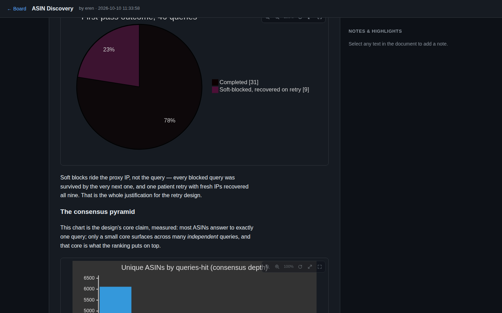
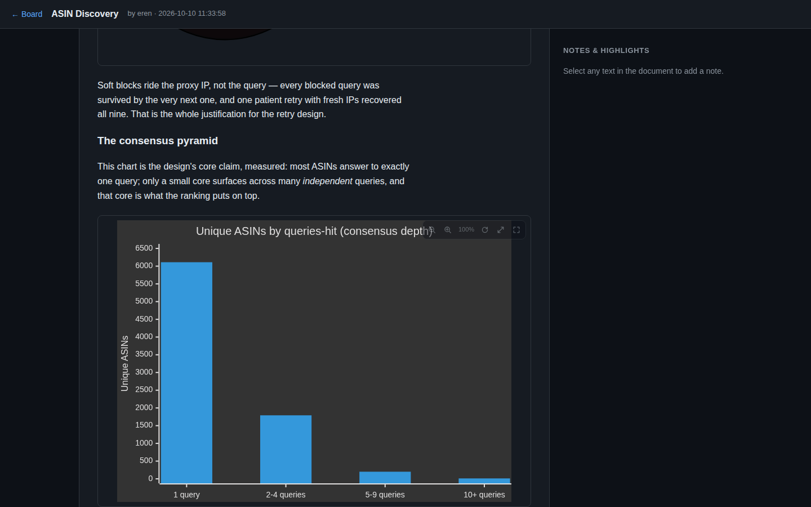

# MDBoard

A tiny self-hosted **markdown review board**. Paste or upload markdown
documents, and review them the way you review code: select any text to
highlight it, attach a note in the margin, and discuss. Charts and diagrams
written as [`mermaid`](https://mermaid.js.org/) fences render inline — with
zoom, pan, expand and fullscreen controls.

Flask + SQLite on the back, vanilla JS on the front. No build step, no
client framework, one dependency-free Python package list.



## Why

Reports, audits, research notes and status docs are written in markdown, but
reviewing them in a gist or a shared drive is friction. MDBoard gives them a
place to live with the two things a review actually needs:

- **anchored feedback** — highlights and notes are pinned to exact character
  ranges of the rendered document, not to "paragraph 4, ish";
- **zero-setup sharing** — one SQLite file, one gunicorn process, done.

## Features

- **Board page** — paste markdown or drop a `.md` / `.markdown` / `.txt`
  file; title is derived from the first heading if you don't give one.
- **Sanitized rendering** — markdown → HTML via
  [python-markdown](https://python-markdown.github.io/) with a strict
  [bleach](https://bleach.readthedocs.io/) allowlist and Pygments code
  highlighting.
- **Highlights & margin notes** — select any text in a document to
  highlight it and optionally attach a note; notes are listed in a sidebar
  and cross-linked to their highlights (and back). Deleting a document
  removes its notes.
- **Mermaid charts** — ` ```mermaid ` fences (flowcharts, pie, xychart,
  sequence, gantt, …) render client-side with mermaid.js, dark theme,
  strict security level. Every chart gets a toolbar:
  - zoom in / out (also `Ctrl`/`⌘` + wheel, incl. trackpad pinch), live
    zoom readout, drag to pan, double-click to reset;
  - **expand** — break the chart out of the text column to near-viewport
    width, and back;
  - **fullscreen** — with automatic contain-fit so tall charts are fully
    visible;
  - charts that fail to parse fall back to a readable source listing.
- **Authors remembered** — the author name is persisted in `localStorage`,
  per browser.



## Quickstart

Python 3.12+:

```sh
python3 -m venv .venv
source .venv/bin/activate
pip install -r requirements.txt
python app.py            # dev server on http://localhost:8000
```

Data lives in a single SQLite file (`mdboard.db`), created on first run.
Backup = copy the file.

To try it without touching your filesystem, the test suite runs against an
in-memory database:

```sh
pip install -r requirements-dev.txt
pytest
```

## API

| Method | Path | Description |
|---|---|---|
| `GET` | `/api/docs` | List documents (no content), newest first |
| `POST` | `/api/docs` | Create a document — `{title?, content, author?}`; title derives from the first heading, author defaults to `anonymous` |
| `GET` | `/api/docs/<id>` | Document + rendered `html` |
| `DELETE` | `/api/docs/<id>` | Delete document and its notes |
| `GET` | `/api/docs/<id>/notes` | List notes, ordered by position |
| `POST` | `/api/docs/<id>/notes` | Create highlight/note — `{quote, note?, author?, start_pos, end_pos}` |
| `DELETE` | `/api/notes/<id>` | Delete a note |

Errors are `{"error": "..."}` with a 4xx status.

## Deployment

MDBoard is a standard WSGI app (`wsgi.py`). Run it behind a real server:

```sh
gunicorn --workers 1 --threads 4 --bind 127.0.0.1:8000 wsgi:application
```

Example systemd unit (`/etc/systemd/system/mdboard.service`):

```ini
[Unit]
Description=MDBoard - shared markdown board
After=network-online.target
Wants=network-online.target

[Service]
Type=simple
User=mdboard
Group=mdboard
WorkingDirectory=/opt/mdboard
ExecStart=/opt/mdboard/.venv/bin/gunicorn --workers 1 --threads 4 \
    --bind 127.0.0.1:8000 wsgi:application
Restart=on-failure
RestartSec=3

[Install]
WantedBy=multi-user.target
```

Then terminate TLS at a reverse proxy (nginx, Caddy, …) or a tunnel
(Cloudflare Tunnel, Tailscale, …).

### Security model

MDBoard has **no built-in authentication or multi-tenancy** — anyone who can
reach it can read and write everything. That is a deliberate scope decision:
it is meant to sit on a tailnet, behind Cloudflare Access, or inside a VPN.
Do not expose a bare instance to the public internet.

Markdown rendering is sanitized server-side (bleach tag/attribute/protocol
allowlist); mermaid renders client-side with `securityLevel: strict`.

## Project layout

| Path | Responsibility |
|---|---|
| `app.py` | Flask app factory, REST routes |
| `db.py` | SQLite connection + schema (`docs`, `notes`) |
| `store.py` | Data access, parameterized queries, plain dicts |
| `render.py` | Markdown → sanitized HTML; mermaid fence handling |
| `static/index.html` | Board page (list / add / delete documents) |
| `static/doc.html` | Document viewer: highlights, notes, chart frames |
| `static/mermaid.min.js` | Vendored mermaid.js (dark theme, strict mode) |
| `tests/` | API + rendering tests (pytest) |

## License

[MIT](LICENSE) · mermaid.js is vendored under its own
[MIT license](https://github.com/mermaid-js/mermaid/blob/main/LICENSE).
